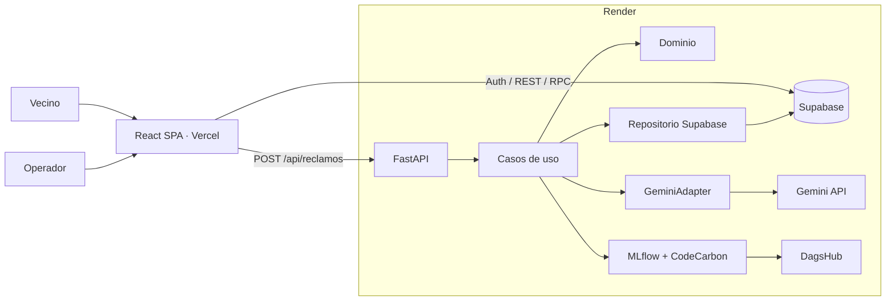

# Reporte de Ingeniería Inversa

**Sistema:** Green AI Municipal – Clasificación ecoeficiente de reclamos vecinales (Municipalidad Provincial de Huancayo)
**Repositorio:** `Marcelo-CC/Taller-de-Proyectos-Software` · rama `main` · commit `73a6f5e`
**Fecha:** 19/11/2026
**Evidencias:** carpeta `evidencias/` (auditoría, dependencias, configuración, ejecución y análisis)

## 1. Resumen Ejecutivo

Se aplicó un proceso de ingeniería inversa en siete fases sobre el repositorio del sistema Green AI Municipal, sin partir de la documentación existente. El sistema resultó ser una aplicación web con **frontend React 19 + Vite (Vercel)**, **backend FastAPI en Python 3.11 (Render)** con **arquitectura hexagonal**, base de datos y autenticación en **Supabase**, clasificación con **Gemini API** y medición de huella de carbono con **CodeCarbon + MLflow (DagsHub)**.

La arquitectura detectada coincide en lo esencial con la declarada. El código es ordenado, tiene 74 pruebas automatizadas, CI bloqueante con auditoría de dependencias y controles de seguridad sólidos (JWT, límite de solicitudes, permisos por columna, hash del código de consulta, anonimización previa a la IA). Se registraron **17 hallazgos**: ninguno crítico, 1 de severidad alta (arranque en frío del backend), 7 medios y 9 bajos. Los principales son la dependencia directa del caso de uso hacia Gemini/MLflow/CodeCarbon, la doble ruta de acceso a datos del SIGEM y la falta de un script de creación de la base. La evaluación arquitectónica promedio es **3,3 / 5**.

## 2. Objetivos

- Identificar las tecnologías, dependencias y servicios del sistema a partir del código.
- Reconstruir el entorno de ejecución de forma reproducible en Linux Ubuntu.
- Ejecutar el sistema y analizar sus logs y endpoints.
- Reconstruir el modelo de dominio, los casos de uso y la arquitectura real.
- Evaluar la calidad arquitectónica y consolidar una matriz de hallazgos con recomendaciones priorizadas.

## 3. Alcance

| Incluido | Excluido |
|---|---|
| 91 archivos versionados: backend (`backend/src`, `tests`, `sql`), frontend (`frontend/src`, `public`), `.github/`, `docs/`, configuración raíz | Datos reales de los vecinos |
| Ejecución local de pruebas y build; pruebas en producción (Render y Vercel) | Valores de las variables secretas (no se leyeron ni se documentan) |
| Servicios externos desde el punto de vista de la integración | Configuración interna de los paneles de Supabase, Render y Vercel más allá de lo observable |
| | Pruebas de carga y de penetración |

## 4. Metodología

Se siguieron 12 prompts organizados en 7 fases; cada uno produjo al menos un archivo de evidencia.

| Fase | Prompt | Evidencia |
|---|---|---|
| 1. Auditoría | 1 Descubrimiento Tecnológico · 2 Detección Arquitectónica | `auditoria/inventario_archivos.md`, `stack_tecnologico.md`, `arquitectura_detectada.md` |
| 2. Dependencias | 3 Dependencias | `dependencias/backend.md`, `frontend.md`, `infraestructura.md` |
| 3. Instalación y configuración | 4 Reconstrucción del Entorno · 5 Variables de Entorno | `configuracion/instalacion.md`, `variables_entorno.md`, `servicios.md` |
| 4. Ejecución | 6 Análisis de Logs · 7 Descubrimiento Funcional | `ejecucion/backend_logs.md`, `frontend_logs.md`, `endpoints_detectados.md`; `analisis/modulos.md` |
| 5. Ingeniería inversa | 8 Reconstrucción del Dominio · 9 Reconstrucción Arquitectónica | `analisis/dominio.md`, `casos_uso.md`, `arquitectura_real.md` |
| 6. Evaluación | 10 Evaluación Arquitectónica · 11 Hallazgos | `analisis/calidad_arquitectura.md`, `hallazgos.md` |
| 7. Reporte final | 12 Generador Final | `docs/ingenieria_inversa.md` |

### 4.1 Auditoría

Clonación del repositorio, inventario con `git ls-files` (91 archivos: 17 de código backend, 16 de pruebas, 5 SQL, 20 del frontend, 9 de documentación, 2 de GitHub y 22 de configuración y recursos) e identificación de tecnologías por archivos de manifiesto, importaciones y configuración.

### 4.2 Instalación

Reconstrucción del procedimiento para Ubuntu 22.04/24.04 con Python 3.11 y Node.js 22 (versiones del CI): entorno virtual, `pip install -r requirements-dev.txt`, `npm ci` y archivos `.env` a partir de `.env.example` (ver `configuracion/instalacion.md`).

### 4.3 Configuración

Extracción de todas las variables de entorno leídas por el código (`os.getenv`, `import.meta.env`): 13 del backend, más `PORT` de Render, y 3 del frontend, clasificadas en secretos, tokens, base de datos y APIs externas. Se identificaron los scripts SQL necesarios y los roles de la base.

### 4.4 Ejecución

`pytest` local (68 aprobadas y 2 módulos omitidos por falta de `fastapi`; en el CI se ejecutan los 74), build del frontend en el CI y pruebas en producción: registro, consulta, acceso denegado sin sesión (401), límite de solicitudes (429), Swagger y arranque en frío.

### 4.5 Ingeniería Inversa

Lectura del código por capas para reconstruir entidades, objetos de valor, servicios, reglas, agregados, repositorios y casos de uso, con diagramas UML textuales (PlantUML y Mermaid); luego reconstrucción y evaluación de la arquitectura real.

## 5. Inventario Tecnológico

| Categoría | Tecnologías |
|---|---|
| Lenguajes | Python 3.11, JavaScript/JSX, SQL (PL/pgSQL), CSS |
| Backend | FastAPI, Uvicorn, Pydantic 2 |
| Frontend | React 19.3, Vite 8.3, Recharts 3 |
| Base de datos y autenticación | Supabase (PostgreSQL, PostgREST, Auth) |
| Inteligencia artificial | Google Gemini (`gemini-flash-lite-latest`, respaldo `gemini-flash-latest`) con `google-genai` |
| Green AI / MLOps | CodeCarbon, MLflow en DagsHub |
| Pruebas y calidad | pytest, ESLint, `pip-audit`, `npm audit` |
| DevOps | GitHub Actions, Dependabot, Render, Vercel |
| Residual sin uso | Node.js/Express/`pg` en `backend/package.json` |

## 6. Arquitectura Detectada

| Estilo | Resultado | Confianza |
|---|---|---|
| Hexagonal (puertos y adaptadores) | **Predominante** en el backend | Alta |
| Por capas | Presente (presentación, aplicación, dominio, infraestructura) | Alta |
| Monolito modular | Presente (un único servicio backend) | Media-alta |
| Clean Architecture | Parcial (la aplicación conoce infraestructura de IA) | Media |
| MVC, microservicios, orientada a eventos | No aplica | Alta |

El sistema completo es una arquitectura **cliente-servidor sobre servicios gestionados** (Supabase como Backend as a Service y Gemini como IA como servicio).

## 7. Dependencias

| Ámbito | Producción | Desarrollo | Observaciones |
|---|---|---|---|
| Backend Python | fastapi, uvicorn, pydantic, python-dotenv, supabase, google-genai, codecarbon, mlflow, dagshub, requests | pytest, pip-audit | Sin archivo de bloqueo; `requests` sin uso directo; Dependabot propone subir 5 mínimos |
| Frontend | react, react-dom, recharts, axios | vite, @vitejs/plugin-react, eslint y complementos | `axios` sin uso; 232 paquetes en el lock; sin vulnerabilidades altas |
| Backend Node | express, pg, @supabase/supabase-js, cors, dotenv | nodemon | **Totalmente sin uso** (121 paquetes en el lock) |
| CI | actions/checkout@v4, setup-python@v5, setup-node@v4 | — | Node.js 20 deprecado; Dependabot propone `@v7` |

Críticas: fastapi/uvicorn, supabase, google-genai (con respaldo local), pydantic, react y vite.

## 8. Configuración

| Variable | Obligatoria | Tipo |
|---|---|---|
| `SUPABASE_URL`, `SUPABASE_KEY` | Sí | Base de datos (la clave es secreta) |
| `GEMINI_API_KEY` | Sí | Secreto · API externa |
| `GEMINI_MODEL`, `GEMINI_MODEL_RESPALDO` | No | API externa |
| `MLFLOW_TRACKING_PASSWORD`, `DAGSHUB_REPO_OWNER`, `DAGSHUB_REPO_NAME` | No | Token · API externa |
| `AUTH_OBLIGATORIA`, `RATE_LIMIT_POR_MINUTO`, `RATE_LIMIT_TOTAL_POR_MINUTO`, `CORS_ORIGINS` | No | Seguridad (no figuran en `.env.example`) |
| `LOG_LEVEL` | No | Operación |
| `VITE_API_URL`, `VITE_SUPABASE_URL`, `VITE_SUPABASE_PUBLISHABLE_KEY` | `VITE_SUPABASE_*` sí | Frontend (clave pública) |

Servicios requeridos: Supabase (con los scripts `modulo_c_consulta.sql`, `hitl_auditoria.sql` y `seguridad_permisos.sql`), Gemini, DagsHub (opcional), Render y Vercel. Ningún secreto está versionado: `.gitignore` excluye `.env*` salvo `.env.example`.

## 9. Ejecución

| Prueba | Resultado |
|---|---|
| `pytest` local | 68 aprobadas, 2 módulos omitidos (falta `fastapi` en el entorno) |
| GitHub Actions | Pruebas, build, `pip-audit` y `npm audit` en verde |
| `GET /` en Render tras inactividad | ~60 s de arranque en frío, luego 200 |
| `GET /api/reclamos` sin token | 401 con mensaje en español |
| `POST /api/reclamos` | Ticket, código secreto, categoría y confianza |
| 21 registros seguidos | 429 |
| Frontend en Vercel | Todas las vistas operativas; SIGEM paginado de 25 en 25 con exportación CSV/PDF |

No se encontraron errores en ejecución. Los hallazgos de logs fueron: arranque en frío (alto), mensajes con `print` y texto del reclamo en logs (medio), pruebas omitidas sin aviso y acciones de CI deprecadas (bajo).

## 10. Reconstrucción Arquitectónica



- **Componentes:** SPA, servicio `api.js`, API FastAPI, seguridad (JWT, limitador, CORS, cabeceras), casos de uso, dominio, adaptadores Gemini y Supabase, base PostgreSQL con lógica SQL, Supabase Auth, telemetría y CI/CD.
- **Flujo de datos:** el backend enmascara los datos personales antes de llamar a Gemini; solo se almacena el texto anonimizado, la categoría, la confianza, la telemetría y el hash del código.
- **Diferencias con lo documentado:** el caso de uso depende directamente de Gemini, MLflow y CodeCarbon (sin puerto), y el SIGEM lee y actualiza directamente en Supabase además de hacerlo por la API.

## 11. Modelo de Dominio

```plantuml
@startuml
class Reclamo <<Entity>> {
  titulo; descripcion; categoria
  estado = PENDIENTE; confianza; requiere_auditoria
}
enum EstadoReclamo <<ValueObject>> { PENDIENTE; EN_PROCESO; RESUELTO }
class codigo_consulta <<ValueObject>> { generar(); hashear() }
class evaluacion_confianza <<DomainService>> { evaluar(); requiere_auditoria() }
interface ReclamoRepositoryPort { guardar(); listar(); listar_pagina(); actualizar_estado() }
class RegistrarReclamoUseCase
class GestionarReclamosUseCase
Reclamo --> EstadoReclamo
RegistrarReclamoUseCase --> evaluacion_confianza
RegistrarReclamoUseCase --> codigo_consulta
RegistrarReclamoUseCase --> ReclamoRepositoryPort
GestionarReclamosUseCase --> ReclamoRepositoryPort
@enduml
```

| Elemento | Contenido |
|---|---|
| Agregado | `Reclamo` (raíz única) |
| Objetos de valor | `EstadoReclamo`, código de consulta `XXXX-XXXX` (guardado como SHA-256); categoría y confianza implícitas |
| Servicio de dominio | `confianza = certeza × ambigüedad × claridad`; umbral HITL 0,70; tope local 0,50 |
| Reglas clave | Enmascarar datos antes de la IA; 4 categorías oficiales; HITL < 70 %; estados válidos; código mostrado una sola vez; trigger que impide cambiar el estado de un reclamo retenido |
| Casos de uso | Registrar reclamo, consultar trámite, iniciar sesión, listar, cambiar estado, auditar categoría, dashboard y exportación |

## 12. APIs e Integraciones

| Tipo | Endpoint / servicio | Acceso |
|---|---|---|
| API expuesta | `GET /` | Público |
| API expuesta | `POST /api/reclamos` | Público, 20/min por IP |
| API expuesta | `GET /api/reclamos?pagina&por_pagina` | Bearer JWT |
| API expuesta | `PATCH /api/reclamos/{id}/estado` | Bearer JWT |
| API expuesta | `/docs`, `/openapi.json` | Público |
| Supabase (desde el frontend) | `/auth/v1/token`, `/rest/v1/reclamos` (GET/PATCH), `/rest/v1/rpc/consultar_reclamo` | Clave pública + JWT |
| Integración | Gemini API | API key, tiempo límite 20 s, modelo de respaldo y clasificación local |
| Integración | DagsHub / MLflow | Token; opcional |

## 13. Hallazgos

| ID | Hallazgo | Severidad | Prioridad |
|---|---|---|---|
| H-01 | Arranque en frío de ~60 s en Render | Alta | P1 |
| H-02 | Caso de uso acoplado a Gemini, MLflow y CodeCarbon | Media | P2 |
| H-03 | Doble ruta de acceso a datos del SIGEM | Media | P2 |
| H-04 | Texto del reclamo impreso en los logs | Media | P1 |
| H-05 | `print` en lugar de `logging` | Baja | P2 |
| H-06 | Limitador de solicitudes en memoria | Media | P3 |
| H-07 | `backend/package.json` de Node sin uso | Baja | P2 |
| H-08 | `axios` y `requests` sin uso | Baja | P2 |
| H-09 | Recursos gráficos sin referencia | Baja | P3 |
| H-10 | Regla de categoría del cliente poco intuitiva | Media | P2 |
| H-11 | Sin script de creación de la tabla `reclamos` | Media | P2 |
| H-12 | Variables no documentadas en los ejemplos | Baja | P2 |
| H-13 | Pruebas de API omitidas sin `fastapi` | Baja | P3 |
| H-14 | Acciones de CI con Node.js 20 deprecado | Baja | P2 |
| H-15 | Sin pruebas del frontend ni de la lógica SQL | Media | P3 |
| H-16 | Despliegue manual en Render | Baja | P3 |
| H-17 | Sin contenedores ni infraestructura como código | Baja | P3 |

Detalle con evidencia, impacto y recomendación en `evidencias/analisis/hallazgos.md`. Fortalezas verificadas: JWT en rutas internas, anonimización previa a la IA, código guardado como hash, trigger HITL, CI bloqueante con Dependabot y rama protegida, y tolerancia a fallas de Gemini y MLflow.

## 14. Riesgos

| Riesgo | Hallazgos | Probabilidad | Impacto | Mitigación |
|---|---|---|---|---|
| Vecinos que abandonan el registro por la demora inicial | H-01 | Alta | Alto | Instancia activa o ping; aviso en la interfaz |
| Dependencia de un único proveedor de IA | H-02 | Media | Medio | Puerto de clasificación; el respaldo local ya existe |
| Divergencia de reglas entre API y base de datos | H-03, H-10, H-15 | Media | Medio | Unificar la ruta y probar el SQL |
| Exposición de contenido en logs de terceros | H-04, H-05 | Media | Medio | Registrar solo métricas |
| Abuso del registro con varias instancias | H-06 | Baja | Medio | Límite compartido |
| Entorno no reproducible ante una pérdida de la base | H-11, H-17 | Baja | Alto | Esquema SQL y `Dockerfile` versionados |
| Desactivar la seguridad por error de configuración | H-12 | Baja | Alto | Documentar `AUTH_OBLIGATORIA` y validar al arrancar |
| CI interrumpido por la retirada de Node.js 20 | H-14 | Media | Bajo | Aceptar los PR de Dependabot |

## 15. Recomendaciones

**Prioridad 1 (inmediata)**
1. Mitigar el arranque en frío (instancia activa o ping programado) y mostrar un aviso de espera en el Portal Ciudadano.
2. Dejar de imprimir texto del reclamo en los logs; registrar solo métricas e ID.

**Prioridad 2 (corto plazo)**
3. Introducir `ClasificadorReclamoPort` y un puerto de telemetría; inyectar las implementaciones desde el router.
4. Unificar el acceso del SIGEM en una sola ruta y documentar la decisión.
5. Validar la categoría enviada por el cliente contra las 4 oficiales o ignorarla.
6. Versionar el `CREATE TABLE reclamos` y completar `.env.example` (backend y frontend).
7. Eliminar `backend/package.json`, `axios` y `requests`; aceptar los PR de Dependabot.
8. Sustituir `print` por `logging`.

**Prioridad 3 (mejora continua)**
9. Limitador de solicitudes compartido.
10. Pruebas de la lógica SQL y de componentes React.
11. `Dockerfile`, `render.yaml` y despliegue automático tras el merge.
12. Limpiar recursos gráficos sin uso y modelar `Categoria` como objeto de valor.

## 16. Conclusiones

1. La ingeniería inversa permitió reconstruir, solo a partir del repositorio y de la ejecución, el stack, la arquitectura, el dominio y las integraciones del sistema, y confirmar que coinciden con lo declarado en el informe del proyecto.
2. El backend sigue una **arquitectura hexagonal** bien aplicada en la persistencia y el dominio (que no depende de frameworks y se prueba aislado), pero incompleta en la integración con la IA y la telemetría.
3. La seguridad está por encima de lo habitual en un proyecto académico (autenticación, límites, permisos por columna, hash del código, anonimización previa a la IA y auditoría de dependencias bloqueante), sin hallazgos críticos.
4. Los principales puntos de mejora son operativos y de mantenibilidad (arranque en frío, doble ruta de datos, restos sin uso y entorno no reproducible al 100 %), y todos tienen una recomendación concreta y priorizada.
5. Con las acciones P1 y P2, la calificación arquitectónica pasaría de 3,3 a alrededor de 4 sobre 5, sobre todo por la mejora en acoplamiento y mantenibilidad.
