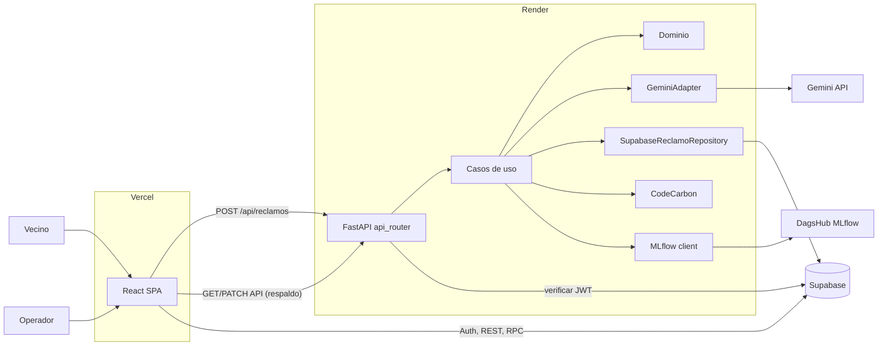

# Arquitectura real encontrada

> Fase 5 · Prompt 9 – Reconstrucción Arquitectónica (rol: Arquitecto Empresarial). Fuentes: código fuente, dependencias, configuración, logs y diagramas de las fases anteriores.

## 1. Arquitectura general

Aplicación web **cliente-servidor sobre servicios gestionados**:

- **Cliente:** SPA en React 19 servida por Vercel.
- **Servidor:** API REST en FastAPI (Render), organizada como **monolito modular hexagonal**.
- **Backend as a Service:** Supabase aporta PostgreSQL, API REST automática (PostgREST), autenticación y lógica en la base (función `SECURITY DEFINER`, trigger, permisos por columna).
- **IA como servicio:** Gemini API.
- **Observabilidad Green AI:** CodeCarbon en proceso + MLflow remoto en DagsHub.

En la práctica es una arquitectura **híbrida**: la escritura de reclamos pasa por la API hexagonal, pero la lectura del SIGEM, la auditoría HITL, el cambio de estado y la consulta del vecino van directo del navegador a Supabase, protegidas por permisos de la base.

## 2. Componentes

| Componente | Tecnología | Responsabilidad |
|---|---|---|
| SPA | React + Vite (Vercel) | Portal ciudadano, consulta, login, SIGEM, dashboard, guía |
| Servicio de datos del cliente | `services/api.js` | Punto único de llamadas HTTP del frontend |
| API REST | FastAPI (`api_router.py`) | Registro, listado y cambio de estado |
| Seguridad de la API | `infrastructure/security/` | JWT (Supabase), límite de solicitudes, CORS, cabeceras |
| Casos de uso | `application/useCases` | Orquestación del registro y la gestión |
| Dominio | `domain/` | Entidad, objetos de valor, servicio de confianza, puertos |
| Adaptador de IA | `GeminiAdapter` | Corrección, anonimización y clasificación con respaldo local |
| Adaptador de persistencia | `SupabaseReclamoRepository` | CRUD de `reclamos` |
| Base de datos | Supabase PostgreSQL | Datos, permisos, `consultar_reclamo`, trigger HITL |
| Autenticación | Supabase Auth | Usuarios municipales y JWT |
| Telemetría | CodeCarbon + MLflow/DagsHub | Energía, emisiones y métricas por inferencia |
| CI/CD | GitHub Actions + Dependabot | Pruebas, build, auditoría de dependencias |

## 3. Relaciones

## 4. Dependencias entre capas

| Desde | Hacia | ¿Respeta la arquitectura? |
|---|---|---|
| `api_router` | casos de uso, DTO, seguridad, repositorio concreto | Sí (adaptador de entrada); arma la inyección importando `supabase` desde `main` |
| Casos de uso | puertos del dominio | Sí |
| `RegistrarReclamoUseCase` | `GeminiAdapter`, `mlflow`, `codecarbon` | **No**: dependencia directa a infraestructura |
| Dominio | nada externo | Sí |
| `SupabaseReclamoRepository` | `ReclamoRepositoryPort` | Sí |
| Frontend | API **y** Supabase | Doble ruta de acceso a datos |

## 5. Integraciones

| Integración | Protocolo | Autenticación | Tolerancia a fallas |
|---|---|---|---|
| Frontend → API | HTTPS/JSON | Ninguna (registro) o Bearer JWT | Mensajes de error en español |
| Frontend → Supabase | HTTPS (PostgREST, RPC, Auth) | Clave pública + JWT | Respaldo a la API para el listado |
| API → Supabase | supabase-py | Clave secreta | 500 genérico con código de incidente |
| API → Gemini | google-genai | API key | Modelo de respaldo + clasificación local |
| API → DagsHub | MLflow | Token | Se omite el registro sin afectar al vecino |

## 6. Flujo de datos

1. **Entrada:** el vecino envía datos personales + texto libre por HTTPS.
2. **Protección:** el backend reemplaza los datos personales por marcadores; Gemini solo recibe texto enmascarado y además anonimiza nombres o direcciones de terceros.
3. **Enriquecimiento:** Gemini devuelve texto corregido, categoría y probabilidades; el dominio calcula la confianza.
4. **Persistencia:** se guarda solo el texto anonimizado, la categoría, la confianza, la telemetría y el hash del código. Los datos personales originales **no** se almacenan.
5. **Métricas:** CodeCarbon mide la inferencia; MLflow registra parámetros y métricas en DagsHub.
6. **Salida:** el vecino recibe ticket y código (una única vez); el operador ve los reclamos en el SIGEM y el dashboard agrega kWh y gCO₂e.

## Conclusión

La arquitectura real coincide en lo esencial con la documentada (hexagonal sobre FastAPI con Supabase y Gemini), pero tiene dos diferencias relevantes: el núcleo depende directamente del proveedor de IA y de la telemetría, y la mitad de las operaciones del SIGEM no pasan por la API, sino que delegan la autorización en los permisos de PostgreSQL. Esa segunda decisión es segura gracias a los `GRANT` por columna y al trigger, pero divide las reglas de negocio entre el backend y la base.
