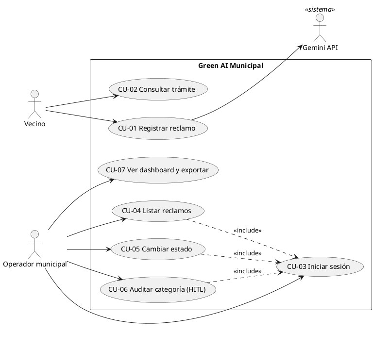
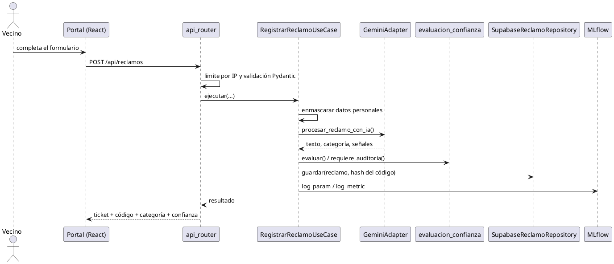

# Casos de uso

> Fase 5 · Prompt 8 – Reconstrucción del Dominio (casos de uso). Fuente: `application/useCases`, `api_router.py`, `frontend/src/services/api.js`, `backend/sql/`.

## Diagrama de casos de uso (UML textual)

## Especificación

| ID | Caso de uso | Actor | Implementación | Precondición | Flujo principal | Resultado |
|---|---|---|---|---|---|---|
| CU-01 | Registrar reclamo | Vecino | `RegistrarReclamoUseCase` vía `POST /api/reclamos` | No superar 20 reclamos/min | Enmascarar datos → medir con CodeCarbon → Gemini (corrige, anonimiza, clasifica) → confianza → generar código → guardar → MLflow | Ticket, código secreto, categoría, confianza |
| CU-02 | Consultar trámite | Vecino | Función SQL `consultar_reclamo` (RPC) | Tener ticket y código | Comparar hash → devolver datos públicos | Estado del reclamo |
| CU-03 | Iniciar sesión | Operador | Supabase Auth (frontend) | Usuario creado en Supabase | Correo + contraseña → JWT | Acceso al SIGEM |
| CU-04 | Listar reclamos | Operador | `GestionarReclamosUseCase.listar/listar_pagina`; el frontend lee primero directo de Supabase | JWT válido | Consulta paginada | Bandeja de reclamos |
| CU-05 | Cambiar estado | Operador | `GestionarReclamosUseCase.cambiar_estado` vía API; el frontend actualiza directo en Supabase | JWT; reclamo no retenido por HITL | Validar estado → actualizar | Nuevo estado |
| CU-06 | Auditar categoría | Operador | `auditarReclamo` en `api.js` (PATCH directo a Supabase) | Reclamo con `requiere_auditoria` | Elegir categoría → `requiere_auditoria = false`, `estado = EN_PROCESO` (solo si seguía retenido) | Reclamo liberado a la gerencia |
| CU-07 | Dashboard y exportación | Operador | `DashboardGreenAI.jsx`, `services/exportar.js` | Sesión | Agregar kWh, gCO₂e y categorías | Gráficos, CSV y PDF |

## Diagrama de secuencia CU-01

## Observación

CU-02, CU-03 y CU-06 no tienen caso de uso en la capa de aplicación del backend: se resuelven en el frontend contra Supabase. CU-04 y CU-05 existen en ambos lados (API y acceso directo), lo que duplica la lógica de acceso.
