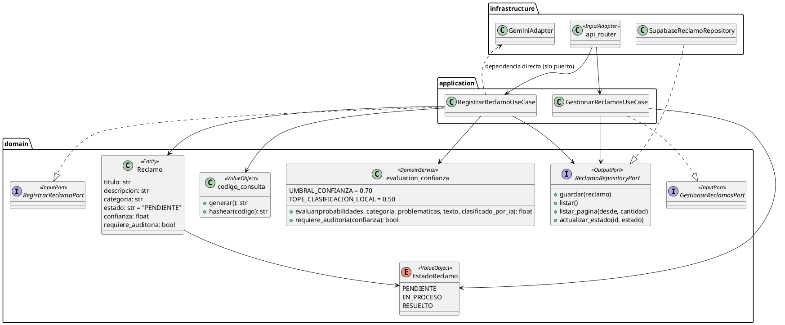
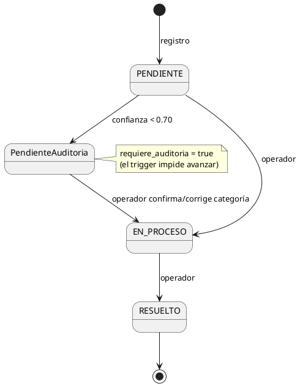

# Modelo de dominio reconstruido

> Fase 5 · Prompt 8 – Reconstrucción del Dominio (rol: experto en Domain Driven Design). Fuente: `backend/src/domain/**`, `backend/src/application/**`, `backend/sql/**`.

## 1. Entidades

**`Reclamo`** (`domain/entities/reclamo.py`): `titulo`, `descripcion`, `categoria`, `estado` (por defecto `PENDIENTE`), `confianza`, `requiere_auditoria`. Su identidad (`id` = número de ticket) la asigna la base de datos. Es una entidad **anémica**: solo guarda datos; las reglas viven en servicios y casos de uso.

## 2. Objetos de valor

| Objeto de valor | Archivo | Descripción |
|---|---|---|
| `EstadoReclamo` | `valueObjects/estado_reclamo.py` | Enumeración `PENDIENTE`, `EN_PROCESO`, `RESUELTO`; rechaza cualquier otro valor |
| Código de consulta | `valueObjects/codigo_consulta.py` | 8 caracteres en formato `XXXX-XXXX` con alfabeto sin caracteres confusos (sin 0/O, 1/I/L, U); se genera con `secrets` y se guarda solo su SHA-256 |
| Categoría (implícita) | `gemini_adapter.py` | Vías Públicas, Limpieza Pública, Parques y Jardines, Alumbrado. **No está modelada como objeto de valor** en el dominio |
| Confianza (implícita) | `services/evaluacion_confianza.py` | Número 0–1 con 4 decimales |

## 3. Servicios de dominio

**`evaluacion_confianza`**: `confianza = certeza × factor de ambigüedad × factor de claridad`.

| Señal | Regla |
|---|---|
| Certeza | Probabilidad normalizada de la categoría elegida; 0,50 si el modelo no la entregó |
| Ambigüedad | 1 problemática = 1,0; 2 = 0,80; 3 o más = 0,60 |
| Claridad | < 8 palabras = 0,60; < 15 = 0,80; < 25 = 0,90; resto = 1,0 |
| Tope local | Sin IA la confianza no supera 0,50 |
| Decisión | `requiere_auditoria = confianza < 0,70` |

## 4. Reglas de negocio

| ID | Regla | Dónde se aplica |
|---|---|---|
| RN-01 | Los datos personales (nombre, DNI, dirección, contacto) se enmascaran antes de enviar el texto a la IA | `RegistrarReclamoUseCase._enmascarar` |
| RN-02 | Todo reclamo se clasifica en exactamente una de 4 categorías oficiales | `GeminiAdapter`, `_normalizar_categoria` |
| RN-03 | Confianza < 70 % → revisión humana (HITL) | `evaluacion_confianza` |
| RN-04 | Sin IA, la clasificación local nunca se deriva sola (tope 50 %) | `evaluacion_confianza` |
| RN-05 | Solo se aceptan los estados `PENDIENTE`, `EN_PROCESO`, `RESUELTO` | `EstadoReclamo`, `GestionarReclamosUseCase` |
| RN-06 | El código secreto se muestra una sola vez y solo se guarda su hash | `codigo_consulta`, `consultar_reclamo` |
| RN-07 | Un reclamo retenido por HITL no puede cambiar de estado mientras siga marcado para auditoría; al auditarlo pasa a `EN_PROCESO` | Trigger `proteger_auditoria_hitl` (base de datos) |
| RN-08 | Si la corrección de la IA recorta el texto (< 85 % de las palabras), se conserva el original | `GeminiAdapter._revisar_correccion` |
| RN-09 | Si el cliente envía una categoría distinta de "Vías Públicas", prevalece sobre la de la IA | `RegistrarReclamoUseCase` (regla poco intuitiva; ver hallazgos) |

## 5. Agregados

**Agregado `Reclamo`** (raíz: `Reclamo`), que agrupa estado, categoría, confianza, marca HITL, telemetría (kWh, gCO₂e) y hash del código. Todas las modificaciones (estado, categoría auditada) pasan por la raíz mediante su `id`. No hay otros agregados: los usuarios municipales pertenecen al contexto de Supabase Auth.

## 6. Repositorios

`ReclamoRepositoryPort` (puerto) con `guardar`, `listar`, `listar_pagina`, `actualizar_estado`; implementado por `SupabaseReclamoRepository` y, en pruebas, por `RepositorioFalso` (`tests/dobles.py`).

## 7. Casos de uso

Detallados en `casos_uso.md`: **Registrar reclamo**, **Listar reclamos**, **Cambiar estado**, y desde el frontend contra la base: **Auditar categoría (HITL)** y **Consultar trámite**.

## Diagrama de clases (UML textual, PlantUML)

## Diagrama de estados del reclamo

## Explicación

El dominio es pequeño y está centrado en un único agregado, `Reclamo`. Lo más valioso del modelo está en el servicio `evaluacion_confianza` y en los objetos de valor del estado y el código de consulta, que no dependen de ningún framework y se prueban de forma aislada. Las debilidades son una entidad anémica, una categoría que no está modelada como tipo propio (vive como texto en el adaptador de IA) y una regla de negocio importante (RN-07) que solo existe en la base de datos.
